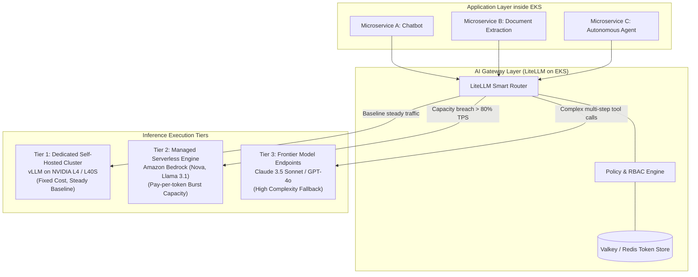
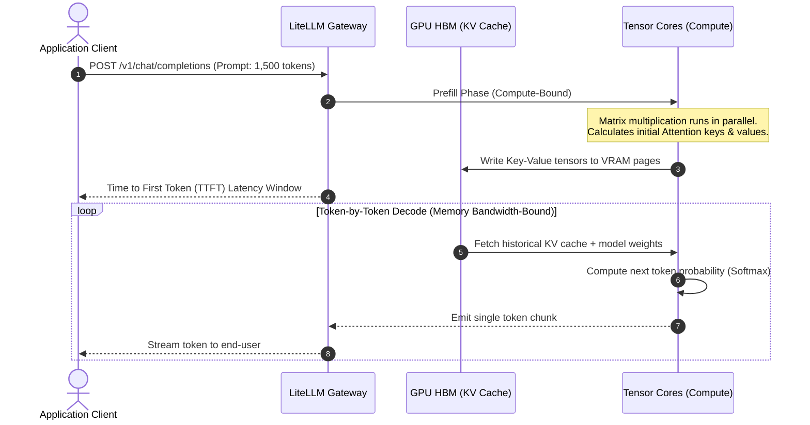
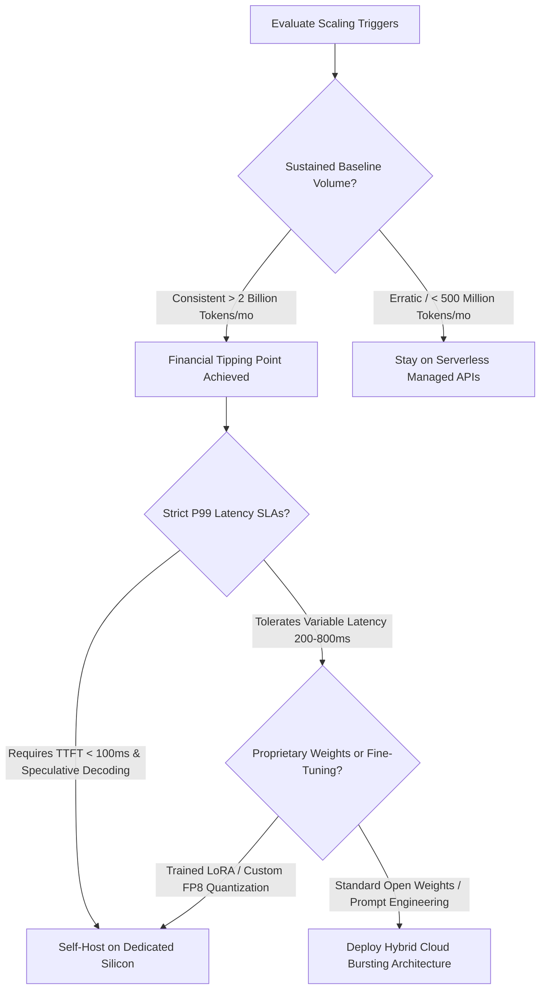
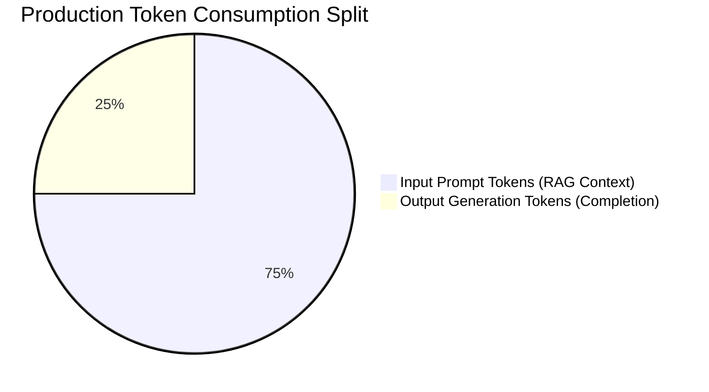
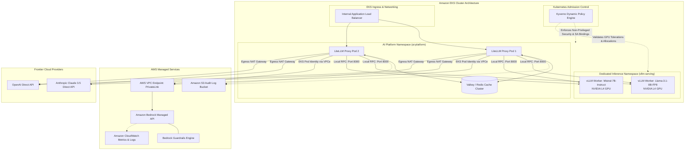
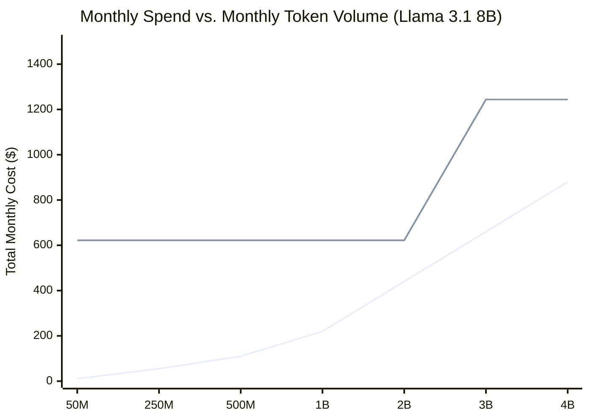
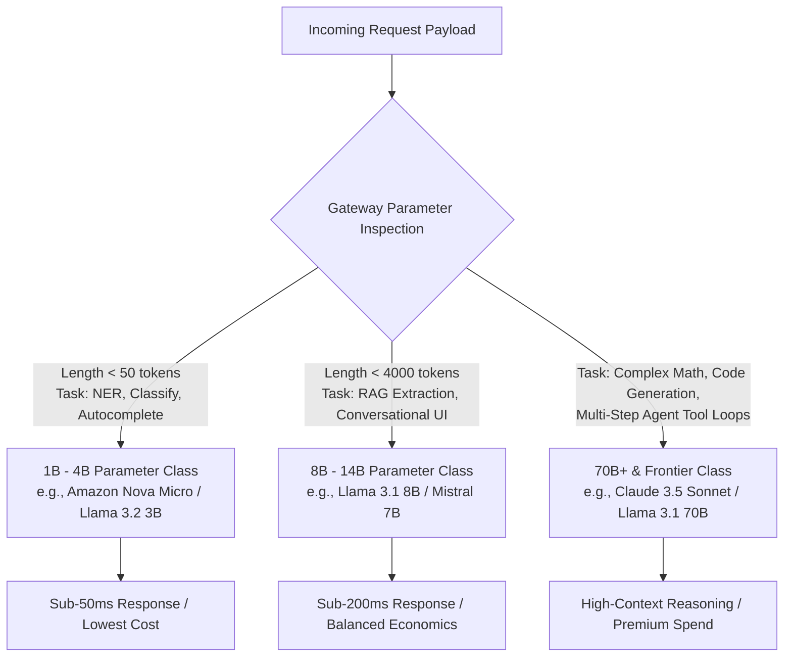

*By Shankar Ramanathan*

Renting dedicated GPUs before you understand your token distribution is the fastest way to burn your infrastructure budget on idle silicon.

Every engineering team building generative AI applications faces the same fork in the road. You can pay a managed provider like Amazon Bedrock a premium per million tokens to abstract away hardware completely, or you can provision dedicated GPU nodes inside an Amazon Elastic Kubernetes Service (EKS) cluster and run inference engines like vLLM yourself.

The right answer is almost never an absolute choice between managed and self-hosted. The real production architecture is a hybrid one, where a Kubernetes-native AI gateway routes baseline traffic to dedicated capacity, bursts spikes to managed serverless endpoints, and directs complex reasoning tasks to frontier models. This post also explores the Token Tipping Point, when to Move Beyond Amazon Bedrock to Hybrid Inference on EKS and the Governance capabilities that has to be baked-in for a reliable, observable and economically regulated environment for Inference workloads.

Here is the exact data, architectural patterns, and economic tipping points required to decide where your inference workloads should run.

```
                                [ Incoming Prompt Traffic ]
                                             │
                                             ▼
                      ┌──────────────────────────────────────────────┐
                      │    LiteLLM AI Gateway on Amazon EKS          │
                      │    (Admission: Kyverno | State: Valkey)      │
                      └───────┬──────────────┬──────────────┬────────┘
                              │              │              │
         Low-Latency Baseline │              │ Peak Burst   │ Frontier Reasoning
         High-Volume (e.g. 8B)│              │ (> 75% VRAM) │ (Code, Math, Agents)
                              ▼              ▼              ▼
                     ┌──────────────┐ ┌──────────────┐ ┌──────────────┐
                     │ Self-Hosted  │ │Amazon Bedrock│ │External Cloud│
                     │ vLLM Cluster │ │Serverless API│ │Frontier APIs │
                     │ (Neocloud/EC2│ │(Llama, Nova) │ │(Claude 3.5,  │
                     │ L4 / L40S)   │ │              │  GPT-4o)       │
                     └──────────────┘ └──────────────┘ └──────────────┘
```

---

## What Is Hybrid Inference Routing?

Before running calculations on token economics, we need to clarify what these three hosting models mean in production.

**Managed Inference (Serverless APIs)**: Platforms like Amazon Bedrock expose foundation models through a standard REST or gRPC endpoint. You do not manage virtual machines, CUDA libraries, GPU memory allocations, or driver upgrades. You pay strictly for the tokens you send (input tokens) and the tokens generated (output tokens). The cloud provider absorbs the cost of keeping spare hardware warm across multiple availability zones.

**Self-Managed Inference (Dedicated Clusters)**: You provision compute instances equipped with hardware accelerators (such as NVIDIA A10G, L4, L40S, or H100 or H200  GPUs) on AWS EC2 or specialized neoclouds (RunPod, CoreWeave, Lambda Labs). You deploy an optimized model serving runtime like vLLM or Triton Inference Server inside Kubernetes. You pay for the instance per hour regardless of whether it processes 10,000 tokens per second or sits idle at 3 AM.

**Hybrid Inference Routing**: A unified gateway layer sits in front of all application microservices inside your Kubernetes cluster. The gateway analyzes incoming requests by user budget, required capability, prompt size, and current cluster load. Steady-state, repetitive, or fine-tuned workloads route to cost-effective self-managed instances. Sudden traffic spikes burst to serverless Bedrock APIs without dropping packets. Highly complex analytical requests route to frontier models like Anthropic Claude 3.5 Sonnet or OpenAI GPT-4o.



---

## The Hardware Mechanics: Memory Bandwidth, KV Caching, and Compute Saturation

To understand why dedicated GPUs sit idle and drain money, you have to look at the mechanics of large language model inference. LLM inference splits into two completely different computational phases:

1. **The Prefill Phase (Prompt Processing)**: The model processes the full prompt context in parallel. This phase is compute-bound. The GPU matrix multiplication units (Tensor Cores) run at near-maximum floating-point operations per second (FLOPs).
2. **The Decode Phase (Token Generation)**: The model produces one token at a time sequentially. Each new token depends on all previous tokens. This phase is memory bandwidth-bound. The GPU must stream every single parameter weight from High Bandwidth Memory (HBM) into on-chip cache just to produce a single word.



The limiting factor on a self-hosted GPU is almost never compute cores; it is GPU VRAM capacity and memory bandwidth.

Every active user request requires maintaining a Key-Value (KV) cache in VRAM throughout the entire conversation turn. For an 8-billion parameter model like Llama 3.1 8B running in 16-bit precision (FP16), the model weights alone consume 16 GB of VRAM. A standard 24 GB GPU like the NVIDIA A10G or L4 leaves you with only 8 GB of VRAM for the KV cache.

If an incoming request includes a large RAG document of 8,000 prompt tokens, its KV cache consumes roughly 1 GB of VRAM on its own. With just 8 concurrent users submitting documents, your 24 GB GPU is out of memory (OOM), forcing subsequent requests into queues.

Modern inference serving systems like vLLM addressed this memory waste through PagedAttention, which allocates KV cache memory in non-contiguous physical blocks (pages) similar to virtual memory in operating systems. This reduces internal memory fragmentation from 60% down to under 4%.

Even with PagedAttention, quantization and continuous iteration-level batching, a dedicated GPU node represents a hard ceiling on concurrent connections. If your traffic drops to zero, you pay the full hourly rate for the machine. If traffic spikes 5x above your VRAM threshold, requests stall in your queue, driving Time-to-First-Token (TTFT) from 120 milliseconds to 15 seconds.

Managed providers like Amazon Bedrock mitigate this problem by maintaining massive pools of shared hardware. They spread the prefill load across hundreds of nodes and pack decode streams across thousands of virtualized slices, eliminating the penalty of underutilized VRAM on your corporate credit card.

---

## When Pure Managed Inference Wins: The Five Clear Indicators

Managed serverless inference through Amazon Bedrock is the right operational default for most teams. Deploying dedicated GPU infrastructure prematurely introduces massive operational debt without providing financial return.

Managed inference makes clear technical and business sense under the following conditions:

### 1. High Diurnal Swings and Low Base Concurrency

If your traffic mirrors business hours, peaking at 150 requests per second between 10 AM and 3 PM, then dropping to 0.2 requests per second overnight and on weekends, serverless inference wins.

Paying per token on Bedrock means your overnight bill is zero dollars. Maintaining an auto-scaled GPU cluster on EKS requires keeping minimum node groups warm across multiple availability zones. Cold starting a 24 GB GPU container image on EKS (pulling an 18 GB image and downloading 16 GB of weights from Amazon S3 or Hugging Face) takes between 4 and 9 minutes. If your cluster scales from 2 nodes to 10 nodes during a traffic spike, users will experience timeouts while your node group initializes.

### 2. Fast Prototyping and Unproven Feature Adoption

When launching a new generative AI feature, your primary uncertainty is product-market fit, not GPU utilization. Building Terraform modules, configuring Kubernetes Karpenter node pools, writing Kyverno policies, and setting up Prometheus GPU exporters can take weeks of engineering time.

Bedrock enables you to hit production in hours. You use standard AWS IAM roles, connect via private VPC endpoints, and call foundation models through an API. If the feature fails to gain traction, you delete the client configuration with zero stranded capital expenditure or long-term instance commitments.

### 3. Avoiding the GPU Allocation Bottleneck

Obtaining reservations for high-demand accelerators like NVIDIA H100 or H200  or L40S instances on major cloud providers often requires committing to 1-year or 3-year enterprise contracts with minimum spends exceeding $100,000. When supply constraints hit, hyperscalers restrict on-demand GPU instance creation in popular regions.

Bedrock absorbs capacity planning behind its managed API. AWS manages the hardware pool, failovers, and physical replacements. Your team never gets an `InsufficientInstanceCapacity` error when launching a microservice.

### 4. Lean Platform Engineering Teams

Running dedicated GPU nodes is not equivalent to running stateless web microservices. GPUs introduce a unique failure matrix:

* PCIe bus communication stalls
* CUDA out-of-memory crashes that fail to drop process memory cleanly
* Silent tensor corruption
* Host OS NVIDIA driver version mismatches with container CUDA runtime libraries

If your engineering organization lacks dedicated machine learning platform engineers who understand how to configure PyTorch memory allocators, NCCL communication fabrics, and specialized Kubernetes health checks, managed Bedrock APIs save substantial operational overhead.

### 5. Multi-Model Product Requirements

If your application requires an 8B model for text classification, a multimodal model for processing invoices, an embedding model for vector search, and a high-tier reasoning model for code generation, self-hosting requires provisioning four separate GPU node groups. The minimum hardware footprint across three availability zones would require at least 12 dedicated GPUs running 24/7.

On Bedrock, your application makes standard API calls to Amazon Nova Micro, Nova Premier, Llama 3.1 70B, and Titan Embeddings without provisioning a single compute instance.

---

## When Hybrid and Self-Managed Inference Engines Make Sense

The economics reverse once a product achieves consistent, high-volume production scale. The tipping point occurs when the cost of developer time and hardware leases falls below the aggregate cost of pay-per-token API invoices.

Dedicated or hybrid inference becomes technically and financially necessary under the following conditions:



### 1. High, Predictable 24/7 Baseline Volume

When an application generates tens of millions of tokens every hour across global time zones, serverless pay-per-token fees scale linearly with volume. In contrast, dedicated GPU costs are fixed.

Once a cluster achieves a sustained baseline utilization above 65%, running an optimized serving framework on leased or reserved instances yields a drastically lower total cost per million tokens. The excess volume above the baseline can still burst to Bedrock.

### 2. Predictable Time-to-First-Token (TTFT) and Latency SLAs

On shared public managed endpoints, your requests queue alongside workloads from other tenants. When noisy neighbors submit massive batched jobs, your interactive chat application can experience sudden p95 and p99 latency spikes.

With dedicated GPUs inside your EKS cluster, you control scheduling. You can pin memory, tune KV cache allocation, configure chunked prefill sizes, and deploy speculative decoding (where a tiny draft model proposes tokens that the larger base model validates in a single forward pass). This guarantees sub-100 millisecond TTFT for latency-critical user interfaces.

### 3. Custom Weights, LoRA Adapters, and Deep Quantization

Managed platforms provide limited options for custom model configurations. If your data science team fine-tunes a model with specialized domain knowledge (such as medical terminology or legal contract parsing), serving it on a managed service requires either uploading full weight checkpoints to custom model endpoints (which carry high hourly provisioning costs) or shoehorning parameters into provider-specific adapter formats.

Self-hosting gives you full control of the software runtime. You can dynamically swap dozens of LoRA adapters on top of a single shared base model using vLLM's multi-LoRA feature, or run aggressive FP8 and AWQ quantization kernels to double your serving throughput on smaller, cheaper GPUs.

### 4. Data Perimeter and Air-Gapped Compliance

In defense environments, specific banking tiers, and sovereign cloud zones, data egress rules strictly forbid sending prompt payloads across public internet boundaries or shared multi-tenant service planes.

Deploying dedicated GPU workers inside your private Amazon EKS VPC ensures that prompts, context embeddings, and generated completions never leave your isolated subnets.

---

## Phase 1 Telemetry: Tracking the Metrics That Actually Matter

You cannot design a hybrid architecture until you measure how your applications consume tokens. Most engineering teams fail at this step because standard Application Performance Monitoring (APM) tools only track HTTP request rates and response codes. They have no visibility into token distributions.

Before making any infrastructure migration, you must deploy an LLM gateway layer to establish your baseline telemetry across five critical metrics.



### 1. The Input-to-Output Token Ratio

Managed providers charge different rates for input and output tokens. On Amazon Bedrock, generating an output token is roughly 3x to 4x more expensive than reading an input token.

On dedicated hardware, output tokens are even more punitive: they consume GPU memory bandwidth for the entire duration of the decode loop. If your workload is RAG-heavy (e.g., 4,000 input tokens yielding a 100-token answer), your system is compute-bound during prefill. If your workload is generative code creation (e.g., a 200-token prompt yielding a 2,000-token output), your system is memory bandwidth-bound during decode.

### 2. Peak-to-Base Concurrency Ratio

Calculate your peak requests per second (RPS) divided by your minimum baseline RPS over a 30-day window:

$$\text{Peak-to-Base Ratio} = \frac{\text{RPS}_{\text{peak}}}{\text{RPS}_{\text{base}}}$$

If your ratio is 20:1, buying dedicated GPUs for peak capacity will destroy your budget. Your nodes will sit idle 85% of the week. If your ratio is 2:1 or 1.5:1, your workload is an ideal candidate for dedicated hardware, with managed Bedrock endpoints absorbing the occasional peak.

### 3. Time-to-First-Token (TTFT) vs. Inter-Token Latency (ITL)

* **TTFT**: The elapsed time between when the client sends the HTTP request and when the first token chunk arrives. This measures queue waiting time plus prompt prefill compute time.
* **ITL**: The time between subsequent generated tokens. This measures the memory bandwidth speed of the decode loop.

If your TTFT on Bedrock spikes during certain hours of the day, that is empirical evidence of shared provider queue contention, indicating a need for dedicated local capacity.

### 4. Cache Hit Rates and Prefix Sharing

If multiple microservices send identical system prompts or large documentation headers, an inference engine supporting prefix caching (like RadixAttention in SGLang or automatic prefix caching in vLLM) can reuse the KV cache across requests. This skips the prefill phase entirely, dropping TTFT from 800ms to 20ms and cutting GPU compute consumption to near zero.

Standard managed APIs often process full prompts without prefix reuse, charging you full price for repetitive text on every single call.

---

## Architecture: Deploying LiteLLM Gateway as the AI Traffic Plane on Amazon EKS

To govern, monitor, and intelligently route inference across managed and dedicated systems, you need a centralized control plane. Deploying LiteLLM Gateway inside your Amazon EKS cluster creates a unified OpenAI-compatible endpoint for all internal workloads.



### Core Components of the EKS Gateway Architecture

1. **Kyverno Dynamic Admission Engine**: Validates every manifest submitted to the cluster. It ensures that only pods running in the authorized `ai-platform` namespace can mount the AWS IAM ServiceAccount linked to Amazon Bedrock. It rejects containers requesting privileged execution modes or unapproved host mounts.
2. **LiteLLM Proxy Deployment**: A stateless, highly available container deployment running behind an internal Application Load Balancer. It translates client requests into provider-specific schemas (e.g., converting OpenAI `/v1/chat/completions` JSON schemas into Bedrock Converse API payloads or raw vLLM tensors).
3. **Valkey / Redis Sidecar Cluster**: Stores real-time token tracking data, rate-limiting windows, and per-user financial balances. Because this memory store lives inside the EKS cluster network, balance checks and rate-limit verifications complete in sub-millisecond latencies without adding overhead to the LLM invocation.
4. **AWS EKS Pod Identity**: Eliminates long-lived static AWS credentials. The LiteLLM pod automatically inherits short-lived, rotated AWS IAM credentials mapped directly to its Kubernetes ServiceAccount, granting least-privilege permissions to invoke specific Amazon Bedrock model ARNs via private VPC endpoints.
5. **Local Dedicated vLLM Endpoints**: Headless Kubernetes services routing to dedicated GPU worker pods running inside your EKS worker node groups, handling steady-state workloads.

---

## Production LiteLLM Routing and Guardrail Configuration

The following production `config.yaml` demonstrates how to configure LiteLLM on EKS to handle multi-tier routing, automated fallbacks, and real-time spend limits.

```yaml
# LiteLLM Production Configuration for Amazon EKS
general_settings:
  master_key: os.environ/LITELLM_MASTER_KEY
  store_model_in_db: false
  enforce_user_param: true
  max_user_budget: 100.0
  budget_duration: 30d

litellm_settings:
  cache: true
  cache_params:
    type: redis
    host: valkey-service.ai-platform.svc.cluster.local
    port: 6379
    password: os.environ/VALKEY_PASSWORD
  drop_params: true
  set_verbose: false
  success_callback: ["s3", "prometheus"]
  failure_callback: ["s3", "prometheus"]
  s3_callback_params:
    s3_bucket_name: os.environ/LITELLM_AUDIT_LOG_BUCKET
    s3_region_name: us-east-1

router_settings:
  routing_strategy: usage-based-routing
  redis_host: valkey-service.ai-platform.svc.cluster.local
  redis_port: 6379
  redis_password: os.environ/VALKEY_PASSWORD
  enable_pre_call_checks: true
  num_retries: 3
  timeout: 15
  retry_after: 1

model_list:
  # Tier 1: Local Dedicated Self-Hosted Models (Primary Workhorses)
  - model_name: internal-workhorse
    litellm_params:
      model: openai/meta-llama/Llama-3.1-8B-Instruct
      api_base: http://vllm-llama8b.vllm-serving.svc.cluster.local:8000/v1
      api_key: "not-needed-internal"
      rpm: 6000
      tpm: 5000000

  # Tier 2: Managed Serverless Capacity (Cloud Burst & High Concurrency)
  # Uses the Bedrock Application Inference Profile ARN for granular team metrics
  - model_name: internal-workhorse-burst
    litellm_params:
      model: bedrock/arn:aws:bedrock:us-east-1:123456789012:application-inference-profile/team-core-workhorse-profile
      aws_region_name: us-east-1

  # Tier 3: Managed Frontier Reasoning Models via Application Inference Profile
  - model_name: frontier-reasoning
    litellm_params:
      model: bedrock/arn:aws:bedrock:us-east-1:123456789012:application-inference-profile/team-core-claude-profile
      aws_region_name: us-east-1

  # Tier 4: Direct Fallback Frontier Provider
  - model_name: frontier-reasoning-fallback
    litellm_params:
      model: openai/gpt-4o
      api_key: os.environ/OPENAI_API_KEY

# Dynamic Fallback Matrix
router_settings:
  fallbacks:
    - internal-workhorse: [internal-workhorse-burst]
    - frontier-reasoning: [frontier-reasoning-fallback]
```

This configuration achieves three critical architectural outcomes:

1. **Automatic Saturation Bursting**: Requests targeting `internal-workhorse` hit the local EKS vLLM pod first. If the local pod hits capacity limits, runs out of memory, or fails health checks, LiteLLM redirects the payload to `internal-workhorse-burst` on Amazon Bedrock.
2. **Cross-Provider Resilience**: If an AWS region experiences an outage or Bedrock API quotas are throttled, requests targeting `frontier-reasoning` instantly fall back to OpenAI GPT-4o without client application code knowing an error occurred.
3. **Hard Budget Enforcement**: Every request must carry an authenticated user identifier. LiteLLM queries the local Valkey cache before forwarding traffic. If an individual team breaches their monthly budget, LiteLLM returns an immediate HTTP 429 Too Many Requests status code, blocking downstream cloud costs.

---

## The Math Behind the Tipping Point: Managed Bedrock vs. Leased GPU Economics

To determine when self-hosting pays for itself, you must compare unit costs against actual hardware utilization curves. Many teams incorrectly compare peak hardware throughput against serverless pricing, assuming their GPUs will run at 100% capacity continuously.

Let us evaluate the actual numbers for an industry-standard workload: **Llama 3.1 8B Instruct**.

### Cost Parameters (Market Rates)

* **Amazon Bedrock Serverless (Llama 3.1 8B)**:
  * Input pricing: **$0.22 per 1,000,000 tokens** ($0.00022 / 1K)
  * Output pricing: **$0.22 per 1,000,000 tokens** ($0.00022 / 1K)
  * Blended cost (assuming a 3:1 input-to-output ratio): **$0.22 per 1M tokens**
* **Dedicated GPU Node (NVIDIA L4, 24 GB VRAM)**:
  * On-Demand / Neocloud rate: **$0.85 per hour**
  * Monthly fixed cost: $\$0.85 \times 24 \text{ hours} \times 30.5 \text{ days} = \mathbf{\$622.20\text{ per month}}$
* **Serving Throughput (Optimized vLLM Engine on NVIDIA L4)**:
  * Sustained operational throughput under mixed input/output load: **650 tokens per second (TPS)**
  * Maximum theoretical monthly token capacity:
    $$650 \text{ tokens/sec} \times 60 \times 60 \times 24 \times 30.5 = \mathbf{1.71 \text{ Billion tokens / month}}$$



### Scenario Analysis: Walking Through the Volume Thresholds

#### Scenario A: Low Volume or High Fluctuations (50 Million Tokens / Month)

* **Amazon Bedrock Spend**: $50 \times \$0.22 = \mathbf{\$11.00}$
* **Dedicated GPU Spend**: $\$622.20$ (1 leased GPU running continuously)
* **Actual Hardware Utilization**: $50\text{M} / 1,710\text{M} = \mathbf{2.9\%}$
* **Verdict**: **Stay 100% on Bedrock Managed Services.** Buying a dedicated GPU here burns over $600 per month on an idle processor.

#### Scenario B: Growing Application with Baseline Traffic (500 Million Tokens / Month)

* **Amazon Bedrock Spend**: $500 \times \$0.22 = \mathbf{\$110.00}$
* **Dedicated GPU Spend**: $\$622.20$
* **Actual Hardware Utilization**: $500\text{M} / 1,710\text{M} = \mathbf{29.2\%}$
* **Verdict**: **Stay on Bedrock.** Even though the volume has grown tenfold, serverless efficiency beats dedicated hardware until utilization crosses roughly 60%.

#### Scenario C: The Financial Tipping Point (2.8 Billion Tokens / Month)

* **Amazon Bedrock Spend**: $2,800 \times \$0.22 = \mathbf{\$616.00}$
* **Dedicated GPU Spend (1 Instance)**: $\$622.20$
* **Actual Hardware Utilization**: Single GPU is at roughly 95% capacity during working hours, requiring a second GPU for multi-AZ high availability and failover:
  $$\text{Two Dedicated GPUs} = 2 \times \$622.20 = \mathbf{\$1,244.40}$$
* **The Hybrid Solution**:
  * Lease **1 dedicated GPU** ($622.20) to handle your consistent, round-the-clock baseline load of 1.8 billion tokens.
  * Route the remaining 1.0 billion tokens of variable peak daytime traffic to **Amazon Bedrock** ($220.00).
  * **Total Hybrid Cost**: $\$622.20 + \$220.00 = \mathbf{\$842.20}$
  * You maintain sub-100ms baseline latency on your dedicated node while avoiding the cost of paying for a second idle GPU that only runs during afternoon spikes.

### Comprehensive Cost and Operational Comparison Matrix

| Architectural Feature | AWS Bedrock (Managed Serverless) | Dedicated vLLM on EKS (Single GPU) | Hybrid Intelligent Routing (EKS + Bedrock) |
| :--- | :--- | :--- | :--- |
| **Pricing Model** | Pay-per-token ($/1M tokens) | Fixed hourly lease ($/hr/node) | Base hardware lease + burst tokens |
| **Idle Cost Risk** | Zero | High (100% cost during zero traffic) | Low (Base node sized strictly to min baseline) |
| **Hardware Scarcity Exposure** | None (Absorbed by AWS) | High (Requires active GPU capacity allocation) | Low (Bursts to AWS during node shortages) |
| **Engineering Maintenance** | Minimal (Standard API calls) | Heavy (CUDA updates, memory tuning) | Moderate (Standard gateway config management) |
| **P99 TTFT Consistency** | Variable (Shared tenant queues) | Consistent (Dedicated VRAM allocation) | Consistent for baseline; variable for bursts |
| **Custom Weight / LoRA Support** | Restricted to vendor options | Total control (Dynamic multi-LoRA swapping) | Custom models local; generic models remote |
| **Data Perimeter Boundary** | Multi-tenant AWS service plane | Private EKS VPC subnet | Private VPC with private AWS endpoints |

---

## Route Slicing: Parameter-Based Model Matching

Routing every user prompt to an expensive frontier model is an expensive anti-pattern. A major benefit of deploying an AI gateway on EKS is the ability to inspect prompt metadata and dispatch tasks to the smallest parameter class capable of executing them.



### 1. The 1B to 4B Parameter Class (The Classifiers and Extractors)

* **Models**: Amazon Nova Micro, Llama 3.2 1B / 3B, Qwen 2.5 3B.
* **Workloads**: Real-time autocomplete, Named Entity Recognition (NER), intent routing, prompt categorization, and simple JSON formatting.
* **Economics**: Extremely cheap on Bedrock ($0.035 to $0.05 per 1M tokens) and can easily be packed onto tiny, cost-effective edge compute nodes without requiring high-end VRAM.

### 2. The 8B to 14B Parameter Class (The Core Enterprise Workhorses)

* **Models**: Llama 3.1 8B Instruct, Mistral 7B, Gemma 2 9B.
* **Workloads**: General Retrieval-Augmented Generation (RAG) extraction, document summarization, natural language customer service dialogues, and content drafting.
* **Economics**: Represents 70% to 80% of all standard enterprise LLM traffic. This parameter tier represents the highest return on investment when moving from serverless APIs to local self-hosted vLLM nodes inside EKS.

### 3. The 70B+ and Frontier Class (The Analytical Brains)

* **Models**: Anthropic Claude 3.5 Sonnet, OpenAI GPT-4o, Llama 3.1 70B / 405B, Amazon Nova Premier.
* **Workloads**: Multi-step agentic workflows, autonomous tool calling, complex software code synthesis, architectural validation, and legal/financial audits.
* **Economics**: Operating a 70B model self-hosted requires an 8x GPU node (such as an AWS `g5.48xlarge` or `p4d.24xlarge` equipped with 8 x NVIDIA A100 GPUs) costing between $16 and $32 per hour. Unless you generate hundreds of millions of tokens every day specifically through these models, running them on serverless Bedrock APIs is significantly cheaper.

---

## Moving from Architecture to Implementation (Part 2)

Understanding the financial tipping points and the multi-tier routing architecture is only half the battle. In production, allowing microservices to query these models without strict controls leads to runaway spending, shared quota starvation, and admission security holes.

In [Part 2: Enterprise Governance with RBAC, Kyverno Model Whitelisting, and Bedrock Inference Profiles](./managed-vs-hybrid-inference-litellm-eks-part2.md), we implement the full Kubernetes-native control plane:
* **Admission-Level RBAC with Kyverno**: Establishing an authoritative ConfigMap entitlement matrix and anti-tamper admission checks to prevent model forgery.
* **Bedrock Application Inference Profiles**: Mapping profiles 1-to-1 per team for dedicated quota isolation and AWS CUR cost tagging.
* **Dual-Plane Observability**: Combining sub-second Prometheus metrics with CloudWatch invocation log filters.
* **Declarative Zero-Downtime Circuit Breaking**: Using Crossplane in Observe-Only mode, Kyverno context variables, modular directory-mounted ConfigMaps, and LiteLLM live config watching (`LITELLM_WATCH_CONFIG=True`) to drop breached teams without container restarts.

---

## References & Technical Documentation

* [How to Track and Limit Amazon Bedrock Usage by User (AWS re:Post)](https://repost.aws/articles/ARoDnASCxDQyGFfaagReMZNw/how-to-track-and-limit-amazon-bedrock-usage-by-user)
* [LiteLLM Proxy Official Architecture and Documentation](https://docs.litellm.ai/docs/simple_proxy)
* [Analysis of Global GPU Scarcity and Neocloud Economics](https://www.spheron.network/blog/gpu-shortage-2026/)
* [Amazon Bedrock model lifecycle](https://aws.amazon.com/blogs/machine-learning/understanding-amazon-bedrock-model-lifecycle/)
* [Enforce zero data retention on Amazon Bedrock](https://aws.amazon.com/blogs/security/enforce-zero-data-retention-on-amazon-bedrock-with-bedrock-projects-and-service-control-policies/)
* [Multi-Provider Generative AI Gateway](https://aws.amazon.com/blogs/machine-learning/streamline-ai-operations-with-the-multi-provider-generative-ai-gateway-reference-architecture/)
