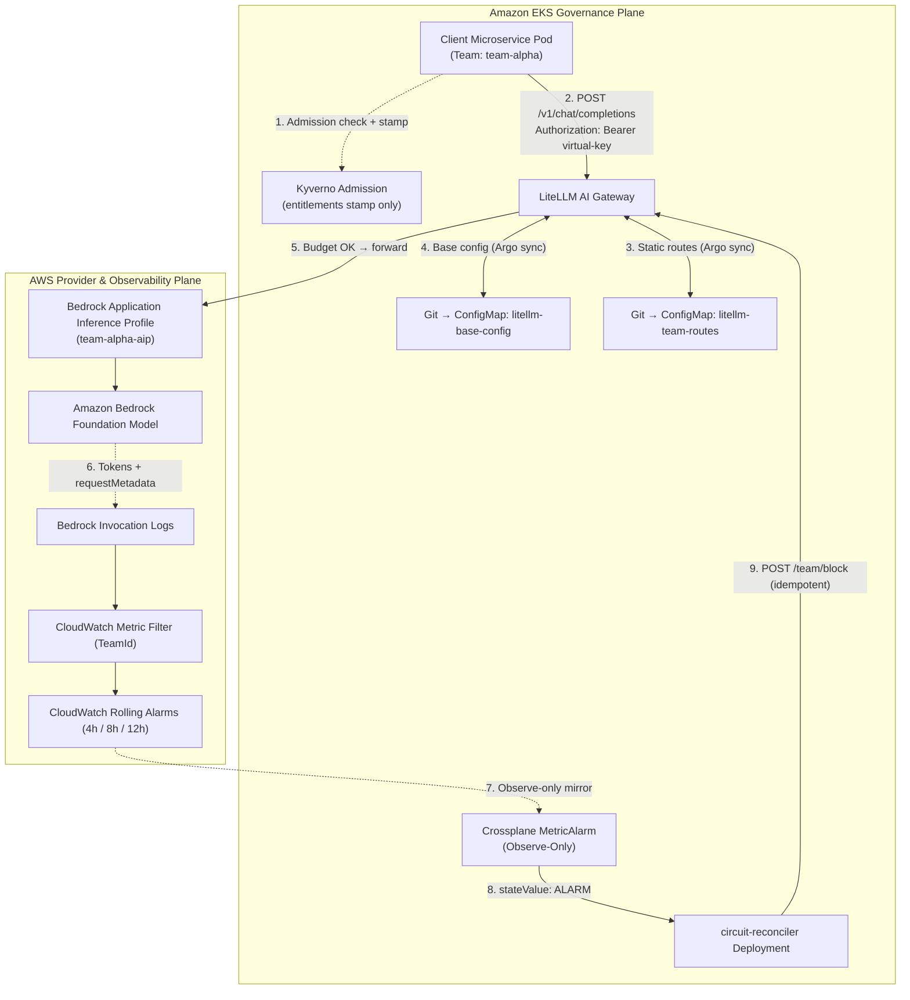
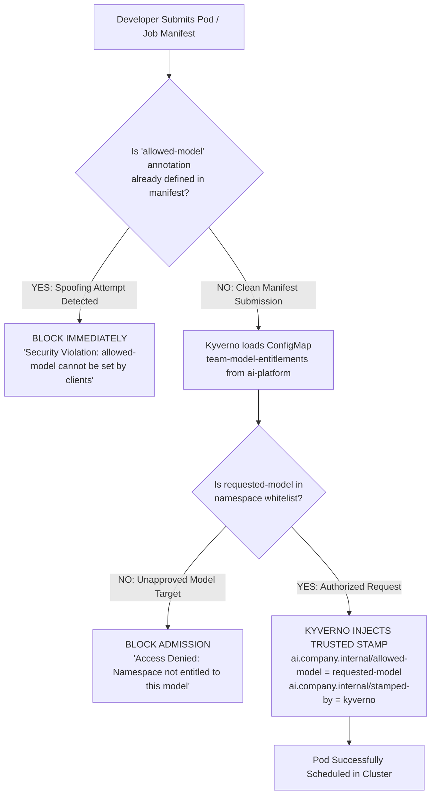
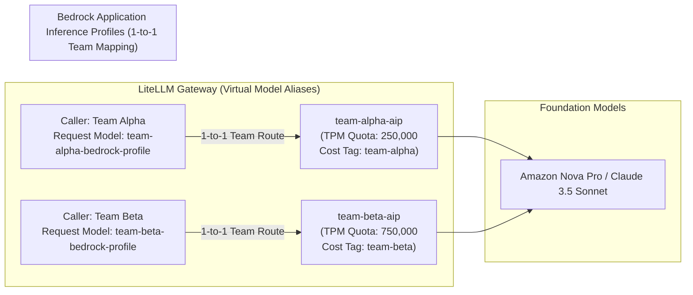
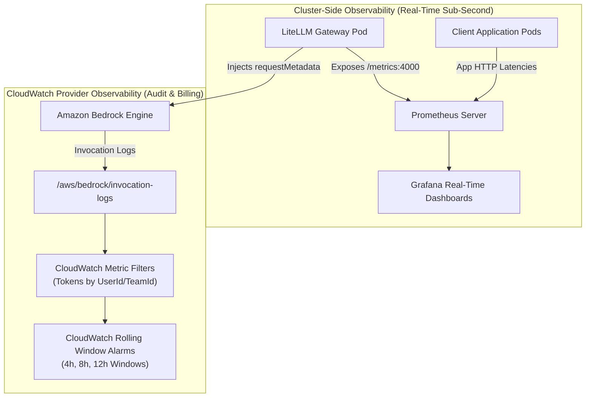
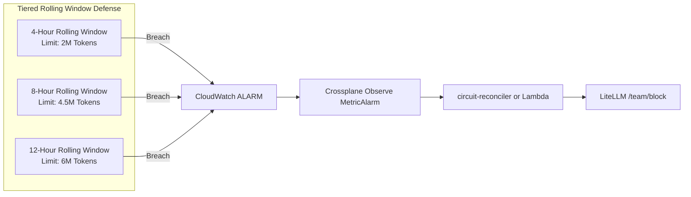
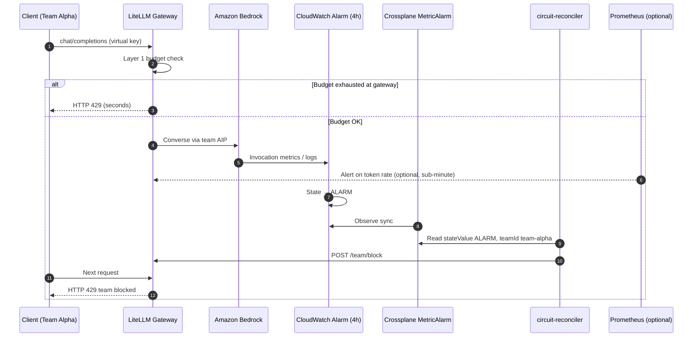
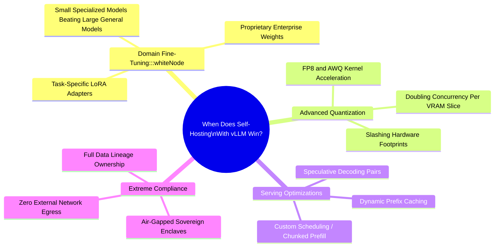

*By Shankar Ramanathan*

In [Part 1 of this series](./managed-vs-hybrid-inference-litellm-eks-part1.md), we established the unit economics of LLM inference, the financial tipping point between managed Bedrock serverless APIs and dedicated GPU nodes, and the multi-tier routing architecture.

Now in Part 2, we implement the complete governance and enforcement engine inside Amazon EKS.

When multiple application pods share an AI gateway, governance cannot rely on trust. Without automated policy enforcement, a runaway agent loop or an unoptimized batch job can consume millions of tokens in minutes, running up substantial unplanned cloud spend.

Governing a multi-tenant generative AI platform on Amazon EKS requires coordinating four distinct enforcement tiers:

1. **Cluster Admission Control (Kyverno)**: Restricts namespace capabilities, validates pod security profiles, and binds client identities strictly to allowed model lists.
2. **AI Gateway Policy & Runtime Enforcement (LiteLLM)**: Enforces API key authorization, team spend allocations, rate limits, and sub-millisecond circuit breaking.
3. **Bedrock Application Inference Profiles**: Isolates AWS account quotas, provides cost-allocation tags for the AWS Cost and Usage Report (CUR), and prevents noisy-neighbor throttling across business units.
4. **Spend circuit breaking (GitOps config + LiteLLM enforcement)**: Route YAML stays in Git under Argo CD. LiteLLM team budgets and virtual keys block runaway traffic at the gateway in seconds. CloudWatch rolling alarms on Bedrock invocation logs remain the financial backstop; Crossplane mirrors alarm state into the cluster; a small **circuit reconciler** (or optional **EventBridge → Lambda**) calls the LiteLLM management API to block a team when an alarm fires, without patching ConfigMaps or fighting GitOps sync.

The manifests in this post are a deliberate starting point: one `Deployment`, modular `ConfigMap` mounts, and Valkey for shared router state. That matches how many teams first land LiteLLM on EKS. Once you run multiple gateway replicas, team-scoped virtual keys, and an Admin UI in production, LiteLLM's own [manifest-to-microservices migration guide](https://docs.litellm.ai/docs/proxy/manifests_to_microservices) is the upgrade path worth planning for.

**Why move to the componentized Helm chart**

| Single-manifest layout | Microservices chart (`gateway`, `backend`, `ui`) |
| :--- | :--- |
| One Deployment serves inference, key management, and the Admin UI | LLM traffic scales on `litellm-gateway` without dragging management APIs along |
| HPA on CPU scales everything together | Gateway HPA can target request or token rate; backend and UI scale independently |
| Ingress sends all paths to one Service | Path-based routing: `/v1/*` and `/health` to gateway, `/key/*` and `/team/*` to backend, `/ui` to UI |
| Old pods can stay up while you cut over | Chart installs alongside manifest names (`litellm-gateway` vs `litellm-deployment`) for reversible migration |

Postgres and Valkey stay put; you split `DATABASE_URL` into chart values plus a username/password Secret, pin the chart version to your proxy image tag, and point ingress at the gateway Service when you are ready to retire the monolith. Part 2's Kyverno entitlements, team route ConfigMaps, and Crossplane alarms transfer unchanged into `gateway.config.proxy_config` on the chart.

#### Minimal `values.yaml` for an EKS cutover

Install the chart **alongside** your manifest Deployment first (`ingress.enabled: false`), verify readiness on `litellm-gateway:4000`, then flip ingress in step 7 of the [migration guide](https://docs.litellm.ai/docs/proxy/manifests_to_microservices). Pin the chart version to match your proxy image (example uses `1.98.0`).

Merge `litellm-base-config` and the keys from `litellm-team-routes` into `gateway.config.proxy_config` below. Per-team route files remain **Git-owned only**; circuit-breaker state lives in LiteLLM (API/DB), not in mutated ConfigMap keys.

```yaml
# helm upgrade --install litellm oci://ghcr.io/berriai/litellm/chart/litellm \
#   --version 1.98.0 -f values.yaml --wait --timeout 10m

masterKey:
  secretName: litellm-secrets
  secretKey: LITELLM_MASTER_KEY

database:
  writer:
    host: postgres.internal
    port: 5432
    dbname: litellm
    passwordSecret:
      name: litellm-db
      usernameKey: username
      passwordKey: password

redis:
  host: valkey-service.ai-platform.svc.cluster.local
  port: 6379
  passwordSecret:
    name: litellm-secrets
    passwordKey: VALKEY_PASSWORD

gateway:
  envSecrets:
    - litellm-secrets
  extraEnv:
    - name: LITELLM_MODE
      value: "PRODUCTION"
    - name: LITELLM_LOG
      value: "ERROR"
    - name: LITELLM_JOB_ROLE
      value: "serving"
    - name: PROXY_BASE_URL
      value: "https://llm.internal.example.com"
    - name: NO_DOCS
      value: "True"
    - name: NO_REDOC
      value: "True"
    - name: NO_OPENAPI
      value: "True"
  resources:
    requests: { cpu: "1", memory: 4Gi }
    limits: { cpu: "1", memory: 4Gi }
  hpa:
    enabled: true
    minReplicas: 2
    maxReplicas: 10
  config:
    proxy_config:
      general_settings:
        store_model_in_db: true
        disable_env_credential_login: true
        proxy_batch_write_at: 60
        use_redis_transaction_buffer: true
        trusted_proxy_ranges: ["10.0.0.0/8"]
        background_health_checks: true
        health_check_interval: 300
      litellm_settings:
        cache: true
        json_logs: true
        request_timeout: 600
      router_settings:
        routing_strategy: usage-based-routing
        redis_host: os.environ/REDIS_HOST
        redis_port: os.environ/REDIS_PORT
        redis_password: os.environ/REDIS_PASSWORD
        enable_pre_call_checks: true
      model_list:
        - model_name: internal-workhorse
          litellm_params:
            model: openai/meta-llama/Llama-3.1-8B-Instruct
            api_base: http://vllm-llama8b.vllm-serving.svc.cluster.local:8000/v1
            api_key: not-needed-internal
        - model_name: team-alpha-bedrock-profile
          litellm_params:
            model: bedrock/arn:aws:bedrock:us-east-1:123456789012:application-inference-profile/team-alpha-aip
            aws_region_name: us-east-1
            rpm: 10000

backend:
  envSecrets:
    - litellm-secrets
  hpa:
    enabled: true
    minReplicas: 1
    maxReplicas: 3

ingress:
  enabled: false
  # After verification, enable and set host / className for your internal ALB:
  # enabled: true
  # className: alb
  # controller: alb
  # host: llm.internal.example.com
```



### 1. Admission-Level RBAC with Kyverno

Kyverno admission controller process the incoming request by verifying the incoming workload to allowed model. This prevents any model bypassing the model restrictions by manually adding that annotation or forging access to premier frontier models.

>[!NOTE]
> RBAC policy should be established for teams to setup access control via Role/Role-binding mappings and routing the access through the Identity Provider (IdP) to handle the RBAC translation at the cluster boundary. This blog post assumes such access control mechanism exists and does not delve into the implementation details.

1. **`ai.company.internal/allowed-model` is reserved for the platform**: If a developer or CI pipeline attempts to submit a Pod or Job with this annotation already defined, Kyverno blocks admission immediately.
2. **Developers declare intent via `requested-model`**: Client manifests declare what they wish to use through an unprivileged annotation: `ai.company.internal/requested-model: "internal-workhorse"`.
3. **Kyverno verifies against an authoritative entitlement matrix**: Kyverno loads a platform-owned ConfigMap (`team-model-entitlements`) that pre-defines which namespaces are entitled to which virtual model aliases.
4. **Kyverno injects the trusted stamp**: If the requested model is pre-approved for that namespace, Kyverno mutates the pod specification to inject `ai.company.internal/allowed-model: "{{ requestedModel }}"`. Downstream systems trust this annotation because only Kyverno can write it.



>[!IMPORTANT]
> Argo CD and Kyverno only conflict when **two controllers write the same field**. Kyverno stamps pod annotations at admission; Git owns LiteLLM ConfigMaps. Ignore **only** the stamped annotations, not route ConfigMap data.
>
> 1. Instruct Argo CD to ignore differences on dynamic annotations stamped by Kyverno.
> 2. Keep **self-heal enabled** on `litellm-team-routes` so Git remains the source of truth for virtual model → Bedrock AIP mappings.
>
```yaml
resource.customizations.ignoreDifferences.all: |
  jqPathExpressions:
    - '.metadata.annotations | select(. != null) | with_entries(select(.key | startswith("ai.company.internal/")))'
```

#### Step 1: The Authoritative Entitlements Matrix (`team-model-entitlements`)

Deploy a centralized ConfigMap in the protected `ai-platform` namespace. Individual development teams have no write permissions to this namespace, ensuring the entitlement mapping cannot be altered by developers:

```yaml
apiVersion: v1
kind: ConfigMap
metadata:
  name: team-model-entitlements
  namespace: ai-platform
data:
  # Pre-approved namespace -> allowed virtual model aliases
  team-alpha: "team-alpha-bedrock-profile,internal-workhorse"
  team-beta: "team-beta-bedrock-profile,internal-workhorse"
  team-analytics: "internal-workhorse"
  team-fraud: "team-fraud-bedrock-profile,frontier-reasoning,internal-workhorse"
```

#### Step 2: The Two-Stage Stamping Policy

In Kubernetes admission control, **Mutating Webhooks execute before Validating Webhooks**. If a validating rule simply checked whether `allowed-model` was non-empty, it would see Kyverno's own stamped annotation and reject every legitimate pod.

To resolve this execution order challenge, Rule 1 checks for client tampering, Rule 2 validates that the requested model is authorized for that namespace, and Rule 3 injects the verified platform stamp:

```yaml
apiVersion: kyverno.io/v1
kind: ClusterPolicy
metadata:
  name: enforce-model-entitlement-and-stamping
spec:
  validationFailureAction: Enforce
  background: false
  rules:
    # Rule 1: Anti-Tamper Check - Reject manifests attempting to set 'allowed-model' or forge 'stamped-by'
    - name: block-spoofed-allowed-model-annotation
      match:
        any:
          - resources:
              kinds: ["Pod", "Job"]
      exclude:
        any:
          - resources:
              namespaces: ["kube-system", "ai-platform", "vllm-serving"]
      validate:
        message: >-
          Security Policy Violation: 'ai.company.internal/allowed-model' and 'stamped-by' are restricted platform attributes.
          Client manifests must not define these annotations directly. Specify 'ai.company.internal/requested-model' instead.
        deny:
          conditions:
            all:
              - key: "{{ request.object.metadata.annotations.\"ai.company.internal/allowed-model\" || '' }}"
                operator: NotEquals
                value: ""
              - key: "{{ request.object.metadata.annotations.\"ai.company.internal/stamped-by\" || '' }}"
                operator: NotEquals
                value: "kyverno-admission-controller"

    # Rule 2: Entitlement Verification - Deny if requested model is not permitted for this namespace
    - name: validate-requested-model-entitlement
      match:
        any:
          - resources:
              kinds: ["Pod", "Job"]
      exclude:
        any:
          - resources:
              namespaces: ["kube-system", "ai-platform", "vllm-serving"]
      context:
        - name: entitlements
          configMap:
            name: team-model-entitlements
            namespace: ai-platform
        - name: rawAllowedModels
          variable:
            value: "{{ entitlements.data.{{request.namespace}} || '' }}"
        - name: allowedModelsList
          variable:
            value: "{{ split('{{rawAllowedModels}}', ',') }}"
        - name: requestedModel
          variable:
            value: "{{ request.object.metadata.annotations.\"ai.company.internal/requested-model\" || 'NONE' }}"
      validate:
        message: >-
          Access Denied: Namespace '{{request.namespace}}' requested model '{{requestedModel}}'.
          Authorized models for this namespace are: [{{rawAllowedModels}}].
          Contact the AI Platform team to request entitlement updates.
        deny:
          conditions:
            any:
              # Deny if namespace has no entry in the entitlements map
              - key: "{{ rawAllowedModels }}"
                operator: Equals
                value: ""
              # Deny if requested model is not in the pre-approved whitelist
              - key: "{{ requestedModel }}"
                operator: AnyNotIn
                value: "{{ allowedModelsList }}"

    # Rule 3: Platform Stamping - Kyverno injects the verified 'allowed-model' annotation
    - name: stamp-verified-allowed-model
      match:
        any:
          - resources:
              kinds: ["Pod", "Job"]
      exclude:
        any:
          - resources:
              namespaces: ["kube-system", "ai-platform", "vllm-serving"]
      context:
        - name: requestedModel
          variable:
            value: "{{ request.object.metadata.annotations.\"ai.company.internal/requested-model\" }}"
      mutate:
        patchStrategicMerge:
          metadata:
            annotations:
              ai.company.internal/allowed-model: "{{ requestedModel }}"
              ai.company.internal/stamped-by: "kyverno-admission-controller"

    # Rule 4: Ensure only the gateway pod can mount Bedrock IAM credentials
    - name: restrict-bedrock-service-account
      match:
        any:
          - resources:
              kinds: ["Pod"]
      exclude:
        any:
          - resources:
              namespaces: ["ai-platform"]
      validate:
        message: "Policy Violation: Unauthorized namespace cannot assume bedrock-gateway-sa."
        pattern:
          spec:
            =(serviceAccountName): "!bedrock-gateway-sa"

    # Rule 5: Forbid privileged containers in AI namespaces
    - name: block-privileged-ai-containers
      match:
        any:
          - resources:
              kinds: ["Pod"]
              namespaces: ["ai-platform", "vllm-serving"]
      validate:
        message: "Policy Violation: Privileged containers are strictly forbidden."
        pattern:
          spec:
            containers:
              - securityContext:
                  =(privileged): false
```

#### How Client Workloads Declare Model Intent

Developers deploy workloads specifying their intended model via `requested-model`:

```yaml
apiVersion: apps/v1
kind: Deployment
metadata:
  name: analytics-worker
  namespace: team-analytics
spec:
  replicas: 1
  selector:
    matchLabels:
      app: analytics-worker
  template:
    metadata:
      labels:
        app: analytics-worker
      annotations:
        # Developer specifies intended model alias; Kyverno will validate and stamp allowed-model
        ai.company.internal/requested-model: "internal-workhorse"
    spec:
      containers:
        - name: worker
          image: python:3.11-slim
          command: ["python", "-c", "import time; time.sleep(3600)"]
```

If an engineer in `team-analytics` changes `requested-model` to `frontier-reasoning`, Kyverno catches the mismatch against `team-model-entitlements` and immediately rejects the `kubectl apply` with an exit code 1.

At the API gateway layer, LiteLLM enforces secondary RBAC by issuing virtual keys bound strictly to specific model subsets. A virtual key created for `team-analytics` will reject requests for premier models at runtime anyways:

```bash
# Generate a team-restricted virtual key (use a scoped admin key, not the master key)
curl -X POST 'http://litellm-service.ai-platform.svc.cluster.local:4000/key/generate' \
  -H 'Authorization: Bearer $LITELLM_PLATFORM_ADMIN_KEY' \
  -H 'Content-Type: application/json' \
  -d '{
    "key_alias": "analytics-key",
    "team_id": "team-analytics",
    "max_budget": 250.0,
    "budget_duration": "30d",
    "models": ["internal-workhorse", "internal-workhorse-burst"]
  }'
```

If a client using this key attempts to invoke `frontier-reasoning`, LiteLLM returns an immediate HTTP 400 Bad Request error stating that the key does not possess permissions for that model identifier.

---

### 2. Bedrock Application Inference Profiles: 1-to-1 Team Quotas and Isolation

Calling foundation models using default Bedrock model IDs (such as `anthropic.claude-3-5-sonnet-20241022-v2:0` or `amazon.nova-pro-v1:0`) creates a shared-quota bottleneck. If Team Alpha runs an aggressive batch summarization job, they can exhaust the AWS account's Tokens Per Minute (TPM) limit, throttling real-time customer-facing interactions in Team Beta.

Amazon Bedrock Application Inference Profiles (AIP) solve this by creating distinct logical ARNs for foundation models.

To maintain architectural clarity, Bedrock Application Inference Profiles must map **1-to-1 to a single organizational dimension: either User, Team, or Tenant**. In this architecture, we select the **Team** convention. Mapping 1-to-1 per team aligns infrastructure governance directly with engineering squad ownership, organizational cost centers, and quota boundaries without causing profile management sprawl:

```
arn:aws:bedrock:us-east-1:123456789012:application-inference-profile/team-alpha-aip
```

All Kubernetes resources, LiteLLM aliases, and AWS alarms follow a strict naming convention using a `team-<name>` prefix and descriptive suffixes for uniqueness:

* **Team Identifier**: `team-<name>` (e.g., `team-alpha`, `team-beta`)
* **Bedrock Application Inference Profile**: `team-<name>-aip`
* **LiteLLM Virtual Model Alias**: `team-<name>-bedrock-profile`
* **Crossplane Observe-Only MetricAlarm**: `team-<name>-token-alarm`
* **CloudWatch Metric Alarm**: `Bedrock-TokenBreach-team-<name>-4h`



Using an Application Inference Profile with a 1-to-1 team mapping provides three essential capabilities:

1. **Granular Cost Attribution**: Cost allocation tags((e.g., team ID, application ID, customer/tenant ID, environment) assigned to `team-alpha-aip` flow directly into the AWS Cost and Usage Report (CUR). FinOps teams can trace cloud spend back to the originating team without writing custom billing scraping scripts.
2. **Quota and Rate Limit Isolation**: You can request service quota increases or enforce strict TPS/TPM limits on a specific profile ARN. If `team-alpha` exhausts their allocated TPM ceiling, Bedrock throttles their profile while `team-beta` continues operating at full capacity.
3. **Multi-Region Cross-Region Routing**: Application Inference Profiles can be configured as cross-region profiles. AWS automatically distributes requests across multiple AWS regions (e.g., `us-east-1`, `us-east-2`, and `us-west-2`) to maximize available throughput, bypassing regional capacity bottlenecks while maintaining a single target ARN inside your LiteLLM configuration.

---

### 2b. LiteLLM Security and Production Hardening on EKS

Cluster admission (Kyverno) and gateway policy (virtual keys, spend limits) cover your Kubernetes and API boundaries. LiteLLM still needs proxy-level controls aligned with the [security best practices](https://docs.litellm.ai/docs/proxy/security_best_practices) and [production checklist](https://docs.litellm.ai/docs/proxy/prod).

**Identity and admin access**

Applications must use scoped virtual keys per workload, not the master key. Disable bootstrap Admin UI login from `UI_USERNAME` / `UI_PASSWORD` / master key once SSO or database users exist (`disable_env_credential_login: true`). Behind an internal ALB, set `trusted_proxy_ranges` to your VPC and load balancer CIDRs so failed UI sign-in rate limits key off the real client IP.

**TLS termination at the ALB**

When HTTPS stops at the load balancer, set `PROXY_BASE_URL` to the browser-facing origin, or configure `use_x_forwarded_for` plus `mcp_trusted_proxy_ranges` so session cookies get the `Secure` flag.

**Shrink the attack surface**

Pin an exact image tag (never `main-latest` in production). Set `LITELLM_MODE=PRODUCTION` to disable dotenv loading. Turn off public Swagger, ReDoc, and OpenAPI with `NO_DOCS`, `NO_REDOC`, and `NO_OPENAPI`. Restrict uploads with an `allowed_file_extensions` allowlist if teams use `/v1/files`.

**Throughput and stability**

Use `proxy_batch_write_at: 60` and, above roughly 1000 RPS, `use_redis_transaction_buffer: true`. Cap DB pool size per worker (`database_connection_pool_limit`) against `maxReplicas` so HPA does not exhaust Postgres. Run `--num_workers 1` per pod and scale replicas horizontally; optionally split `LITELLM_JOB_ROLE=serving` on gateway pods and a single `worker` Deployment for budget resets, as in LiteLLM's production topology example.

Section 4 documents the GitOps ConfigMaps (`litellm-base-config`, per-team route keys) with `store_model_in_db: true` so team budgets and blocks persist in Postgres.

---

### 3. Dual-Plane Observability: Prometheus and CloudWatch Metric Filters

Governing production LLM workloads requires observability at both the cluster network plane and the AWS provider plane.



#### Cluster-Plane: Prometheus Integration

LiteLLM exposes a Prometheus `/metrics` endpoint that tracks internal request routing, latency histograms, and budget consumption in real time:

* `litellm_requests_metric`: Tracks request totals partitioned by `model`, `team`, and `user`.
* `litellm_total_tokens`: Tracks token counters partitioned by `token_type` (`input` vs. `output`), `model`, and `team_id`.
* `litellm_remaining_team_budget_metric`: Exposes remaining financial balances per team, allowing platform engineers to build real-time Grafana alerts before a team hits zero balance.
* `litellm_latency_per_output_token`: Tracks generation speeds to identify decode bottlenecks.

Platform engineers configure a standard Prometheus `PodMonitor` or `ServiceMonitor` to scrape the gateway pods every 15 seconds.

For **runaway agent loops**, add Grafana alerts on `litellm_total_tokens` and `litellm_remaining_team_budget_metric` with sub-minute evaluation windows. CloudWatch remains the billing-grade backstop on Bedrock invocation logs; Prometheus catches gateway-side surges before the 4-hour rolling alarm evaluates.

```yaml
apiVersion: monitoring.coreos.com/v1
kind: ServiceMonitor
metadata:
  name: litellm-monitor
  namespace: ai-platform
spec:
  selector:
    matchLabels:
      app: llm-gateway
  endpoints:
    - port: http-metrics
      path: /metrics
      interval: 15s
```

#### Provider-Plane: CloudWatch Invocation Logs & Metric Filters

For requests routed out of the cluster to Amazon Bedrock, the gateway injects the caller's identity directly into the API invocation payload:

```python
# Injection of identity inside LiteLLM's downstream Bedrock adapter
response = bedrock_runtime.converse(
    modelId="arn:aws:bedrock:us-east-1:123456789012:application-inference-profile/team-analytics-profile",
    messages=[{"role": "user", "content": [{"text": user_prompt}]}],
    requestMetadata={
        "userId": "user_49102",
        "teamId": "team-analytics",
        "costCenter": "CC-8402"
    }
)
```

With Bedrock **Model Invocation Logging** directed to a CloudWatch Log Group (`/aws/bedrock/invocation-logs`), Bedrock records the full metadata along with exact input and output token counts for every execution.

Platform engineers configure a **CloudWatch Metric Filter** to isolate token consumption per team:

* **Filter Pattern**: `{ $.requestMetadata.teamId = * && $.inputTokenCount = * && $.outputTokenCount = * }`
* **Metric Name**: `TotalTokensConsumed`
* **Metric Namespace**: `GenerativeAI/Governance`
* **Metric Value**: `$inputTokenCount + $outputTokenCount`
* **Dimension Declarations**:
  * `TeamId = $.requestMetadata.teamId`

>[!NOTE]
> CloudWatch metric dimensions act as strict composite keys. If a metric filter publishes both `TeamId` and `UserId` on the same metric stream, a CloudWatch alarm querying only `TeamId` will evaluate as `INSUFFICIENT_DATA`. We publish `TeamId` as a dedicated single-dimension metric stream so the team-level rolling alarm accurately aggregates token consumption across all users in that team.

---

### 4. GitOps route config and LiteLLM-native circuit breaking

A static 24-hour token budget still leaves a hole for autonomous agents. An infinite tool loop at 9:00 AM can burn through a daily allocation in thirty minutes if you only evaluate budgets once per day.

We use **three enforcement layers** with different speeds, plus a GitOps rule: **Git is the only writer of LiteLLM route YAML**. Kyverno never patches route ConfigMaps at runtime.

#### Three configuration planes (GitOps model)

| Plane | What it holds | Source of truth | How it changes |
| :--- | :--- | :--- | :--- |
| **Entitlements** | Namespace → allowed virtual models | Git (`team-model-entitlements`) | Platform PR |
| **Routes** | Virtual alias → Bedrock AIP / vLLM base URL, nominal RPM in spec | Git (`litellm-team-routes` keys) | Platform PR |
| **Enforcement state** | Team blocked vs active, spend counters | LiteLLM (Postgres/Valkey + audit logs) | Budgets, API block, automation |

Circuit-breaker **state** does not belong in cloned route files. If you mutate `rpm: 0` in a ConfigMap and tell Argo CD to ignore `/data`, Git stops describing production and disaster recovery from Git can accidentally unblock a team still in ALARM.

#### Layer 1: LiteLLM budgets and virtual keys (fastest)

Align team `max_budget`, `budget_duration`, and per-key model allowlists in Git (seeded into LiteLLM with `store_model_in_db: true`). Set gateway budgets **slightly below** CloudWatch alarm thresholds so the proxy returns **HTTP 429** before Bedrock logs accumulate enough tokens to breach the 4-hour window.

When generating keys, bind `team_id`, `max_budget`, and `models[]` so a runaway loop hits the gateway counter in seconds, not after the next CloudWatch evaluation period.

#### Layer 2: CloudWatch rolling alarms (financial backstop)

Configure multi-tier rolling window alarms in Amazon CloudWatch:

1. **4-Hour Window (Catastrophic Surge)**: Sum of `TotalTokensConsumed` over 4 hours (e.g., 2,000,000 tokens). Catches runaway loops and broken retry storms.
2. **8-Hour Window (Shift Ceiling)**: e.g., 4,500,000 tokens across a business day.
3. **12-Hour Window (Half-Day Cap)**: e.g., 6,000,000 tokens for overnight batch guardrails.



#### Layer 3: Emergency actuator (CloudWatch → LiteLLM API)

Crossplane **Observe** mode mirrors each live alarm into `status.atProvider.stateValue`. A thin actuator reacts to `ALARM` / `OK`:

**Option A (default on EKS): in-cluster `circuit-reconciler`**

- One Deployment, ~30s poll loop over `MetricAlarm` objects named `team-*-token-alarm`.
- On `ALARM`: idempotent `POST` to LiteLLM management API (block team or set `max_budget` to 0).
- On `OK`: unblock only if Git declares `autoRecover: true` for that team (see `team-circuit-policy` below). Default is **manual** unblock after incident review.

**Option B: EventBridge → Lambda**

- CloudWatch alarm state change triggers a VPC Lambda that calls the same LiteLLM API through your internal ALB.
- Useful if you already standardize automation on EventBridge and want **zero** extra cluster controllers. You still record blocks in LiteLLM audit logs; secrets and IAM live outside the GitOps repo.

Both options skip ConfigMap reload latency entirely.

#### Modular GitOps route files (static only)

Split configuration so Argo can sync per-team files without monolithic merge conflicts:

1. **Virtual model aliasing**: Clients call `team-alpha-bedrock-profile`, not raw Bedrock ARNs.
2. **`litellm-base-config`**: Global router, cache, security, and shared models (`internal-workhorse`, `frontier-reasoning`).
3. **`litellm-team-routes`**: One ConfigMap key per team (`team-alpha.yaml`, `team-beta.yaml`) checked into Git under `ai-platform/litellm/routes/`.

Nominal `rpm` in Git is a **capacity spec**, not the emergency brake. Do not patch it at runtime.

#### Step 1: Base and team route ConfigMaps (Argo-managed)

```yaml
apiVersion: v1
kind: ConfigMap
metadata:
  name: litellm-base-config
  namespace: ai-platform
data:
  base.yaml: |
    general_settings:
      master_key: os.environ/LITELLM_MASTER_KEY
      store_model_in_db: true
      disable_env_credential_login: true
      disable_error_logs: true
      proxy_batch_write_at: 60
      use_redis_transaction_buffer: true
      database_connection_pool_limit: 10
      trusted_proxy_ranges: ["10.0.0.0/8"]
      use_x_forwarded_for: true
      mcp_trusted_proxy_ranges: ["10.0.0.0/8"]
      allowed_file_extensions: [".jsonl", ".pdf", ".txt"]
      max_file_size_mb: 50
      max_request_size_mb: 250
      background_health_checks: true
      health_check_interval: 300
      health_check_details: false
      enable_drain_endpoint: true

    litellm_settings:
      cache: true
      cache_params:
        type: redis
        host: valkey-service.ai-platform.svc.cluster.local
        port: 6379
        password: os.environ/VALKEY_PASSWORD
      drop_params: true
      set_verbose: false
      json_logs: true
      request_timeout: 600

    router_settings:
      routing_strategy: usage-based-routing
      redis_host: valkey-service.ai-platform.svc.cluster.local
      redis_port: 6379
      redis_password: os.environ/VALKEY_PASSWORD
      enable_pre_call_checks: true
```

```yaml
apiVersion: v1
kind: ConfigMap
metadata:
  name: litellm-team-routes
  namespace: ai-platform
data:
  team-alpha.yaml: |
    model_list:
      - model_name: team-alpha-bedrock-profile
        litellm_params:
          model: bedrock/arn:aws:bedrock:us-east-1:123456789012:application-inference-profile/team-alpha-aip
          aws_region_name: us-east-1
          rpm: 10000

  team-beta.yaml: |
    model_list:
      - model_name: team-beta-bedrock-profile
        litellm_params:
          model: bedrock/arn:aws:bedrock:us-east-1:123456789012:application-inference-profile/team-beta-aip
          aws_region_name: us-east-1
          rpm: 10000
```

Optional Git policy for auto-recovery after CloudWatch clears:

```yaml
apiVersion: v1
kind: ConfigMap
metadata:
  name: team-circuit-policy
  namespace: ai-platform
data:
  team-alpha: |
    autoRecover: false
  team-beta: |
    autoRecover: true
```

#### Step 2: Crossplane IRSA for alarm observation

Crossplane needs read-only CloudWatch access without long-lived access keys in the cluster.

Create an IAM Role (`CrossplaneCloudWatchObserverRole`) with read-only CloudWatch permissions:

```json
{
    "Version": "2012-10-17",
    "Statement": [
        {
            "Sid": "AllowCloudWatchAlarmObservation",
            "Effect": "Allow",
            "Action": [
                "cloudwatch:DescribeAlarms",
                "cloudwatch:GetMetricData",
                "cloudwatch:ListMetrics"
            ],
            "Resource": "*"
        }
    ]
}
```

Bind this IAM role to the Crossplane provider ServiceAccount using EKS Pod Identity or IAM Roles for Service Accounts (IRSA):

```yaml
apiVersion: v1
kind: ServiceAccount
metadata:
  name: cloudwatch-provider-sa
  namespace: crossplane-system
  annotations:
    eks.amazonaws.com/role-arn: arn:aws:iam::123456789012:role/CrossplaneCloudWatchObserverRole
---
apiVersion: aws.upbound.io/v1beta1
kind: ProviderConfig
metadata:
  name: aws-provider-config
spec:
  credentials:
    source: WebIdentity
    webIdentity:
      roleARN: arn:aws:iam::123456789012:role/CrossplaneCloudWatchObserverRole
```

#### Step 3: Observe-only `MetricAlarm` custom resource

```yaml
apiVersion: cloudwatch.aws.upbound.io/v1beta1
kind: MetricAlarm
metadata:
  name: team-alpha-token-alarm
  namespace: ai-platform
  annotations:
    crossplane.io/external-name: "Bedrock-TokenBreach-team-alpha-4h"
spec:
  managementPolicies: ["Observe"]
  forProvider:
    region: us-east-1
    alarmName: "Bedrock-TokenBreach-team-alpha-4h"
    comparisonOperator: GreaterThanThreshold
    evaluationPeriods: 1
    metricName: TotalTokensConsumed
    namespace: GenerativeAI/Governance
    period: 14400
    statistic: Sum
    threshold: 2000000
    dimensions:
      - name: TeamId
        value: team-alpha
  providerConfigRef:
    name: aws-provider-config
```

Crossplane mirrors live state into the CR:

```yaml
status:
  atProvider:
    stateValue: "ALARM"
    stateReason: "Threshold Crossed: 1 datapoint [2450000.0] was greater than the threshold (2000000.0)."
    dimensions:
      - name: TeamId
        value: team-alpha
```

#### Step 4: Circuit reconciler Deployment (Option A)

The reconciler reads `MetricAlarm` status, maps `TeamId` dimensions to LiteLLM `team_id`, and calls the management API using a scoped platform admin key from a Secret (not the master key in application code).

```yaml
apiVersion: apps/v1
kind: Deployment
metadata:
  name: circuit-reconciler
  namespace: ai-platform
spec:
  replicas: 1
  selector:
    matchLabels:
      app: circuit-reconciler
  template:
    metadata:
      labels:
        app: circuit-reconciler
    spec:
      serviceAccountName: circuit-reconciler-sa
      containers:
        - name: reconciler
          image: your-registry/litellm-circuit-reconciler:0.1.0
          env:
            - name: LITELLM_API_BASE
              value: "http://litellm-service.ai-platform.svc.cluster.local:4000"
            - name: LITELLM_PLATFORM_ADMIN_KEY
              valueFrom:
                secretKeyRef:
                  name: litellm-secrets
                  key: LITELLM_PLATFORM_ADMIN_KEY
            - name: RECONCILE_INTERVAL_SECONDS
              value: "30"
            - name: METRIC_ALARM_NAMESPACE
              value: ai-platform
            - name: METRIC_ALARM_NAME_PREFIX
              value: team-
            - name: METRIC_ALARM_NAME_SUFFIX
              value: "-token-alarm"
            - name: TEAM_CIRCUIT_POLICY_CONFIGMAP
              value: team-circuit-policy
```

Example block call (your reconciler wraps this with retries and idempotency):

```bash
curl -sS -X POST "${LITELLM_API_BASE}/team/block" \
  -H "Authorization: Bearer ${LITELLM_PLATFORM_ADMIN_KEY}" \
  -H "Content-Type: application/json" \
  -d '{"team_id": "team-alpha"}'
```

Consult the current [LiteLLM proxy team management docs](https://docs.litellm.ai/docs/proxy/team) for the exact block/unblock endpoints on your pinned version.

#### Step 5: LiteLLM gateway Deployment (static config mount)

Mount Git-synced ConfigMaps. `LITELLM_WATCH_CONFIG` remains useful for **platform PRs** that change routes without restarting pods; it is not the circuit-breaker path.

```yaml
apiVersion: apps/v1
kind: Deployment
metadata:
  name: litellm
  namespace: ai-platform
spec:
  replicas: 2
  selector:
    matchLabels:
      app: llm-gateway
  template:
    metadata:
      labels:
        app: llm-gateway
    spec:
      serviceAccountName: bedrock-gateway-sa
      containers:
        - name: litellm
          image: docker.litellm.ai/berriai/litellm:v1.98.0
          args:
            - "--config"
            - "/etc/litellm/base.yaml"
            - "/etc/litellm/routes/"
            - "--num_workers"
            - "1"
          ports:
            - containerPort: 4000
              name: http-metrics
          env:
            - name: LITELLM_WATCH_CONFIG
              value: "True"
            - name: LITELLM_MODE
              value: "PRODUCTION"
            - name: LITELLM_LOG
              value: "ERROR"
            - name: LITELLM_JOB_ROLE
              value: "serving"
            - name: PROXY_BASE_URL
              value: "https://llm.internal.example.com"
            - name: NO_DOCS
              value: "True"
            - name: NO_REDOC
              value: "True"
            - name: NO_OPENAPI
              value: "True"
            - name: DRAIN_ENDPOINT_TOKEN
              valueFrom:
                secretKeyRef:
                  name: litellm-secrets
                  key: DRAIN_ENDPOINT_TOKEN
          envFrom:
            - secretRef:
                name: litellm-secrets
          resources:
            requests:
              cpu: "1"
              memory: 4Gi
            limits:
              cpu: "1"
              memory: 4Gi
          livenessProbe:
            httpGet:
              path: /health/liveliness
              port: 4000
            periodSeconds: 15
          readinessProbe:
            httpGet:
              path: /health/readiness
              port: 4000
            initialDelaySeconds: 120
            periodSeconds: 15
          lifecycle:
            preStop:
              exec:
                command:
                  - /bin/sh
                  - -c
                  - >-
                    curl -sf -H "X-Drain-Token: ${DRAIN_ENDPOINT_TOKEN}"
                    http://127.0.0.1:4000/health/drain || true;
                    sleep 15
          volumeMounts:
            - name: base-config-volume
              mountPath: /etc/litellm/base.yaml
              subPath: base.yaml
            - name: team-routes-volume
              mountPath: /etc/litellm/routes
      volumes:
        - name: base-config-volume
          configMap:
            name: litellm-base-config
        - name: team-routes-volume
          configMap:
            name: litellm-team-routes
```

#### Feedback loop (sequence)



#### Multi-team onboarding (GitOps)

Add a team without new Kyverno rules:

1. PR to `team-model-entitlements` and `litellm/routes/team-gamma.yaml`.
2. PR a matching `MetricAlarm` observe CR (`team-gamma-token-alarm`).
3. Argo syncs routes; Crossplane watches the alarm; the existing reconciler matches the `team-*-token-alarm` naming convention.

```yaml
apiVersion: cloudwatch.aws.upbound.io/v1beta1
kind: MetricAlarm
metadata:
  name: team-beta-token-alarm
  namespace: ai-platform
  annotations:
    crossplane.io/external-name: "Bedrock-TokenBreach-team-beta-4h"
spec:
  managementPolicies: ["Observe"]
  forProvider:
    region: us-east-1
    alarmName: "Bedrock-TokenBreach-team-beta-4h"
    comparisonOperator: GreaterThanThreshold
    evaluationPeriods: 1
    metricName: TotalTokensConsumed
    namespace: GenerativeAI/Governance
    period: 14400
    statistic: Sum
    threshold: 4500000
    dimensions:
      - name: TeamId
        value: team-beta
  providerConfigRef:
    name: aws-provider-config
```

**Verification checklist**

1. Kyverno rejects client-set `allowed-model`.
2. Virtual key cannot call a model outside its allowlist.
3. Synthetic token burn returns LiteLLM 429 before CloudWatch enters ALARM.
4. Forced `MetricAlarm` status ALARM blocks the team within one reconciler interval.
5. `argocd app diff` shows **no drift** on `litellm-team-routes` after a block event.

---

## The ML Engineering Reality Check: When Self-Hosting with vLLM Makes Sense

It is easy to look at raw hardware spreadsheets and conclude that hosting models yourself will save your company hundreds of thousands of dollars.

In practice, deploying self-hosted models purely to run generic, off-the-shelf open weights (like stock Llama 3.1 8B without modifications) is frequently an operational misstep. Unless your continuous token volume comfortably exceeds 2 to 4 billion tokens per month, the human overhead of managing GPU driver upgrades, node recycling, and cluster monitoring easily outweighs the modest savings on your Bedrock invoice.

Self-hosting with dedicated inference engines like vLLM becomes a distinct advantage when your machine learning engineering team possesses the maturity to customize models:



### 1. Fine-Tuning and Domain Adaptation

A common industry finding is that a finely tuned 8-billion parameter model, trained specifically on high-quality internal company datasets (such as internal support tickets, database schemas, or proprietary legal documents), will consistently outperform a generic 70-billion parameter foundation model on domain-specific benchmarks.

A fine-tuned 8B model requires only a single NVIDIA L4 GPU ($0.85/hr). Serving that same workload through a proprietary managed 70B model or frontier API costs roughly 10x to 15x more per token. If your ML engineering team possesses a reliable fine-tuning pipeline, self-hosting those weights on a dedicated engine delivers a significant competitive and economic advantage.

### 2. Multi-LoRA Adapter Serving

If your product offers personalized AI assistance across multiple business verticals, you do not need to deploy separate base models for each vertical.

Modern serving runtimes allow an engineering team to load a single base model into GPU memory once, and dynamically attach hundreds of lightweight LoRA adapters (ranging from 10 MB to 100 MB each) on the fly based on incoming prompt headers. This capability is difficult to replicate on managed serverless platforms without paying steep dedicated endpoint fees for every single adapter variant.

### 3. Deep Quantization Engineering (FP8 and AWQ)

Running a model in standard 16-bit precision requires 2 bytes of VRAM per parameter. By quantizing weights to 8-bit (FP8) or 4-bit (AWQ) formats, your team cuts the model's memory footprint in half or by three-quarters with minimal loss in benchmark accuracy.

This allows you to run an 8B model comfortably on a lower-tier accelerator, doubling your maximum concurrent user streams per node and cutting your hardware cost per token in half. Managed APIs rarely expose low-level quantization kernel selections to the end user.

---

## Production Failure Modes: Breaking Point and What can be Avoided

Engineering architectures look clean on paper. When deploying hybrid inference gateways under heavy production traffic, systems break in subtle ways. Here are the failure modes encountered and how to address them:

### 1. The Redis/Valkey Cache Bottle-Neck

In high-concurrency configurations, having the LiteLLM gateway synchronously update token balances in Redis on every streaming chunk introduces severe latency jitter.

* **Breaking Point**: Token streaming over Server-Sent Events (SSE) stalled because the proxy executed atomic counter increments against Redis for every token packet.
* **Fix**: Buffer usage tracking locally in gateway process memory and flush aggregated token metrics to the Valkey cache asynchronously at the end of the request stream or in 5-second intervals.

### 2. Upstream Timeout Cascades

When Bedrock throttled requests during sudden traffic bursts, LiteLLM's retry loop held incoming client connections open.

* **Breaking Point**: Client connections accumulated rapidly. The internal Application Load Balancer hit its target group connection limits, causing the gateway pods to crash from memory exhaustion.
* **Fix**: Configure strict timeouts (`timeout: 15`), drop retries to a maximum of 2, and implement aggressive circuit breaking. If Bedrock returns two consecutive HTTP 429 responses, LiteLLM immediately redirects subsequent traffic to secondary providers (e.g., OpenAI or an alternate AWS region) without attempting retries on the primary endpoint.

### 3. Streaming Chunk Reassembly Errors

When proxying streaming responses between different model providers, chunk formats vary subtly. Anthropic SSE chunks, Bedrock converse streams, and OpenAI chat completion streams format delta payloads differently.

* **Breaking Point**: Front-end applications parsing SSE chunks threw JSON parsing exceptions when the gateway dynamically switched providers mid-stream during an automated fallback.
* **Fix**: Enable LiteLLM's standard response transformation headers, ensuring that regardless of which provider serves the completion, the outgoing SSE stream strictly matches the OpenAI `/v1/chat/completions` protocol specification.

---

## Frequently Asked Questions (FAQ)

### What is the typical token volume where self-hosting becomes cheaper than Amazon Bedrock?

For an 8-billion parameter model like Llama 3.1 8B, the financial tipping point typically occurs between 2 and 4 billion tokens per month, assuming your workload maintains a sustained baseline utilization above 60%. If your monthly volume is below 500 million tokens, or if your traffic experiences high diurnal volatility with near-zero activity at night, Amazon Bedrock serverless inference is almost always more cost-effective.

### Can LiteLLM handle streaming tokens with sub-millisecond overhead?

Yes. LiteLLM is designed as an asynchronous Python proxy utilizing `httpx` and `asyncio`. In production deployments on Amazon EKS, the gateway adds between 2 and 5 milliseconds of network latency overhead to the initial Time-to-First-Token (TTFT). For subsequent streaming chunks, the proxy pipes bytes directly through asynchronous generator buffers, introducing virtually no perceptible delay to the end-user.

### How does Kyverno secure AI workloads better than standard Kubernetes RBAC?

Standard Kubernetes RBAC controls cluster-level API actions (such as who can create a Pod or read a Secret). It cannot inspect the internal properties of a manifest at admission time. Kyverno evaluates the contents of deployment manifests before they are scheduled. It verifies that pods requesting GPU resources have explicit resource limits, ensures containers run as non-root, checks that client pods only target whitelisted models allowed for their namespace, and strictly blocks any pod outside the authorized `ai-platform` namespace from mounting the AWS IAM ServiceAccount associated with Amazon Bedrock.

### What is the difference between Time-to-First-Token (TTFT) and Inter-Token Latency (ITL)?

Time-to-First-Token measures the delay between sending a request and receiving the initial token chunk. This window includes network transit, gateway routing overhead, queue waiting time, and prompt prefill compute time. Inter-Token Latency measures the time between each subsequent generated token during the decode phase. TTFT is primarily determined by prompt length and compute availability, while ITL is determined by model parameter size and GPU memory bandwidth.

### Should Kubernetes probes call `/health`, `/health/readiness`, or `/health/liveliness`?

Use the lightweight probe endpoints for the kubelet and load balancer, not `GET /health`.

| Endpoint | Auth | Calls an LLM? | Use for |
| :--- | :--- | :--- | :--- |
| `GET /health/liveliness` | No | No | **Liveness**: process is up (`/health/liveness` is the same route, Kubernetes spelling) |
| `GET /health/readiness` | No | No | **Readiness**: worker can accept traffic; returns 503 if Postgres is configured but unreachable |
| `GET /health` | Virtual key | Yes (every configured model) | **Operations**: model-up checks, dashboards, on-call runbooks |

Pointing a `livenessProbe` at `GET /health` burns provider tokens on every pod every few seconds and can trip rate limits during deploys. With `background_health_checks: true`, operators and monitors can call `GET /health` less often and read cached results while fallbacks still react to unhealthy deployments. For Postgres or cache diagnostics behind auth, use `GET /health/readiness/details` instead of exposing extra fields on the public readiness URL.

### Why use multi-hour rolling window alarms (4h, 8h, 12h) instead of standard 24-hour daily quotas?

A standard 24-hour daily token budget creates a dangerous blind spot for autonomous agent applications. If a microservice enters an unhandled recursion loop or experiences an uncontrolled retry cascade, it can burn an entire team's 24-hour token budget in less than an hour before alerting kicks in. Tiered rolling windows protect your budget at different operational horizons: a 4-hour window catches catastrophic automated loops immediately, an 8-hour window caps usage across a standard business shift, and a 12-hour window enforces half-day stabilization limits.

### How do you circuit-break a team without restarting LiteLLM pods or mutating route ConfigMaps?

Use **LiteLLM enforcement state**, not Git route YAML, for emergency blocks. Layer 1: team budgets and virtual keys return HTTP 429 at the gateway in seconds when spend exceeds limits. Layer 2: CloudWatch rolling alarms on Bedrock invocation logs. Layer 3: when Crossplane mirrors an alarm to `ALARM`, a **circuit reconciler** (or EventBridge → Lambda) calls the LiteLLM management API (for example `/team/block`) idempotently. Route ConfigMaps stay Argo-synced from Git; `argocd app diff` on `litellm-team-routes` stays clean after a block. `LITELLM_WATCH_CONFIG` is for **platform PRs** that change static routes without rolling pods, not for spend emergencies.

### Why not patch `rpm: 0` with Kyverno on a shared ConfigMap?

It couples two writers (Git and Kyverno), often takes minutes to propagate through reload, rewrites the whole team route file on each toggle, and pushes teams toward ignoring ConfigMap `/data` in Argo CD so self-heal does not revert the block. That hides production state from Git and makes DR from Git alone unsafe if an alarm is still firing.

---

## Architecture Checklist and Evaluation Next Steps

Before making any infrastructure commitments, you can follow this phased implementation path:

1. **Deploy Telemetry First**: Deploy LiteLLM on Amazon EKS with Valkey caching. Route 100% of your current traffic through the gateway to Amazon Bedrock serverless endpoints.
2. **Collect 30 Days of Data**: Track your input-to-output token ratios, your peak-to-base concurrency ratio, and your actual monthly token volumes per model tier.
3. **Calculate Your Utilization Curve**: Apply the formula:
   $$\text{Utilization \%} = \frac{\text{Monthly Baseline Tokens}}{\text{Max Theoretical Hardware Throughput}}$$
   If utilization is below 50%, remain on Amazon Bedrock.
4. **Deploy Hybrid Slicing**: If volume crosses 2 billion tokens with a stable baseline, provision an internal GPU node group running an optimized inference engine like vLLM. Configure LiteLLM to serve your baseline traffic locally while keeping Bedrock configured as an automated burst and fallback target.
5. **Enforce Governance**: Apply Kyverno **admission-only** policies for entitlements and Pod Identity. Sync LiteLLM routes from Git via Argo CD. Set LiteLLM team budgets and virtual keys, add Prometheus alerts for fast loops, and deploy Crossplane Observe-only `MetricAlarm` resources plus a circuit reconciler (or EventBridge → Lambda) to block teams via the LiteLLM API when CloudWatch alarms fire.

## References & Technical Documentation

* [LiteLLM Production Best Practices](https://docs.litellm.ai/docs/proxy/prod)
* [LiteLLM Team Management (block / budgets)](https://docs.litellm.ai/docs/proxy/team)
* [LiteLLM Proxy Health Checks](https://docs.litellm.ai/docs/proxy/health)
* [Migrate from Kubernetes Manifests to the Microservices Chart](https://docs.litellm.ai/docs/proxy/manifests_to_microservices)
* [LiteLLM Security Best Practices](https://docs.litellm.ai/docs/proxy/security_best_practices)
* [Deploying LLMs on Amazon EKS using vLLM Deep Learning Containers](https://aws.amazon.com/blogs/machine-learning/deploy-llms-on-amazon-eks-using-vllm-deep-learning-containers/)
* [AWS Samples: Production LiteLLM Bedrock Gateway on EKS](https://github.com/aws-samples/sample-litellm-bedrock-gateway-on-eks)
* [Implementing Resilience Patterns with Amazon Bedrock and LLM Gateways](https://aws.amazon.com/blogs/machine-learning/implementing-resilience-patterns-with-amazon-bedrock-and-llm-gateway/)
* [Bedrock inference profiles](https://docs.aws.amazon.com/bedrock/latest/userguide/inference-profiles.html)
* [Configuring Model Providers with LiteLLM](https://docs.aws.amazon.com/bedrock-agentcore/latest/APIReference/API_HarnessLiteLlmModelConfig.html)
* [Policy Management with Kyverno on Amazon EKS](https://aws.amazon.com/blogs/containers/easy-as-one-two-three-policy-management-with-kyverno-on-amazon-eks/)
